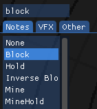
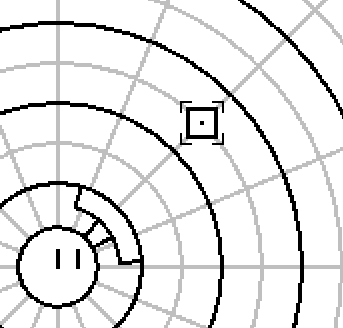
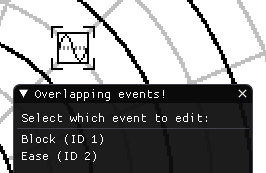
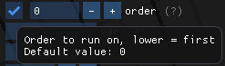

Select your preferred note/event type in the event palette and click on the desired position in the timeline.

Overlapping events will bring up a prompt asking which should be selected.
Remember: you can also *adjust your angle snap* to place events along a greater range of angles, or *manually enter* angle & time positions in the Event editor.

Events with easings that occur at the same time for the same object (ex. a decoration with separate X and Y easings) need to be ordered using the *"order"* function to work properly.

The next section will go over the different note & event types you can select by default, and what their functions are. Other events may not be included but still usable by entering their respective ID in the text field of the Event palette.

# Note Types

|           |                             |                                                           |
| --------- | --------------------------- | --------------------------------------------------------- |
| Block     |  | The most basic note.                                      |
| Hold      |  | Hold notes that the paddle must follow.                   |
| Inverse   |  | Notes that must be hit on the back of the paddle.         |
| Mine      |  | Notes the player must avoid                               |
| Minehold  |  | The same as mines, but occupying an entire range of time. |
| Bounce    |  | Notes that must be hit multiple times                     |
| Side      |  | Notes that must be hit on the side of the paddle          |
| Extra Tap |  | Notes that require a button input.                        |
| Trace     |  | A decorative hold                                         |
