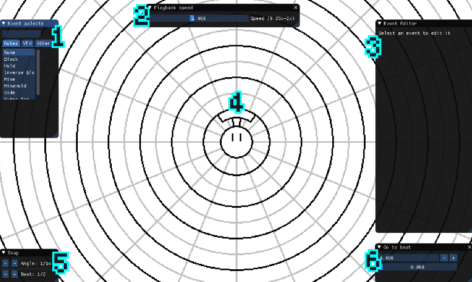

Your editor layout is centered around the *timeline*, a polar graph that notes and events are placed on. \
Specific components are numbered and defined below.

1. **Event palette**
   - Select what note or event types you want to place in this menu.
2. **Playback speed**
   - Use the slider to adjust what speed your level plays at.
3. **Event editor**
   - Change and toggle event properties in this menu.
4. **Cranky**
   - The player character and resident paddle-wielder. Follows the mouse.
5. **Snap**
   - Adjust what angles and timing intervals you want events to snap to.
6. **Go to beat**
   - Jump to beats along a timeline, including negative values.*

*A negative value must first be set in the level properties panel's "Load beat" field.

:::note
To reset the layout back to its default state, you can use Ctrl + R
:::
