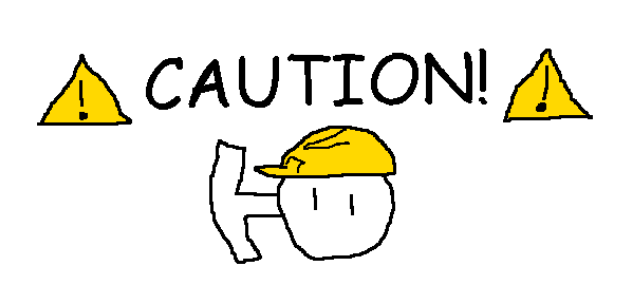

{/* "slug: /" makes it so that this is the index.html */}

This guide is a work in progress!

Please bear with us as some sections are still incomplete.

**If you feel like something is missing, feel free to send a message to @random22
or @cytruss_fruit on discord.**

