{/* "slug: /" makes it so that this is the index.html */}

<div style={{textAlign: 'center'}}>

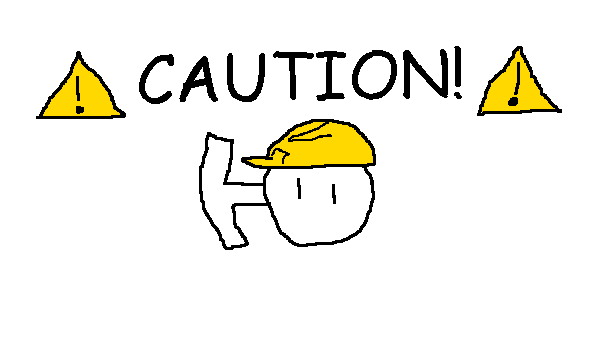

This guide is a work in progress!

Please bear with us as some sections are still incomplete.

**If you feel like something is missing, feel free to send a message to @random22
or @cytruss_fruit on discord.**

</div>

---

# Getting Started

## Navigating the Editor

Your editor layout is centered around the timeline,

a polar graph that notes and events are placed on.

Specific components are numbered and defined below.

|                          |
|--------------------------|
| 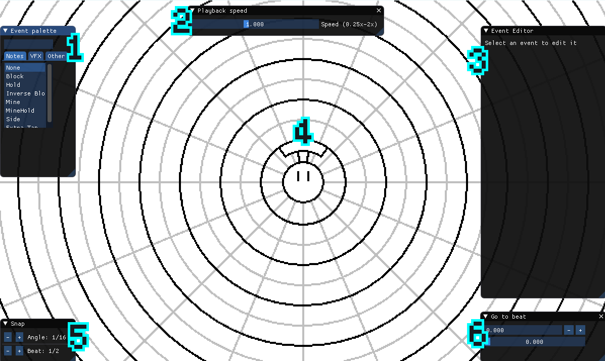 |

1\. Event palette

Select what note or event types you want to place in this menu.

2\. Playback speed

Use the slider to adjust what speed your level plays at.

3\. Event editor

Change and toggle event properties in this menu.

4\. Cranky

The player character and resident paddle-wielder. Follows the mouse.

5\. Snap

Adjust what angles and timing intervals you want events to snap to.

6\. Go to beat

Jump to beats along a timeline, including negative values.*

\*A negative value must first be set in the level properties panel’s “Load beat” field.

To reset the layout back to its default state you can use Ctrl + R

---

## Importing Songs

When you create a new level, you’ll want to select Gameplay &gt; Play song in the event palette before placing the event on your timeline. Remember to set your BPM!

To find the BPM of your song, it is suggested to use a BPM tapper. Good BPM tappers include:  
[https://all8.com/tools/bpm.htm](https://www.google.com/url?q=https%3A%2F%2Fall8.com%2Ftools%2Fbpm.htm&sa=D&source=editors&ust=1795465856744034&usg=AOvVaw3YUwcWuxTEUSkvV9DrHduY)

[https://flat9.glitch.me/](https://www.google.com/url?q=https%3A%2F%2Fflat9.glitch.me%2F&sa=D&source=editors&ust=1795465856744180&usg=AOvVaw3wjyfD_tjP3_b1ZRpkPjVZ)

Try to avoid using a search engine to find the BPM, they often give inaccurate results!

.ogg files are heavily preferred for Play song events, but .wav files are usable. MP3 files are no longer usable.

Offset can either be adjusted in the editor, or manually by cutting the song in a separate program (ex. Audacity.)

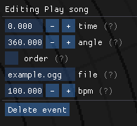

Opening the level properties panel \[Ctrl + I] allows you to add and edit basic level info that appears on the song select screen.

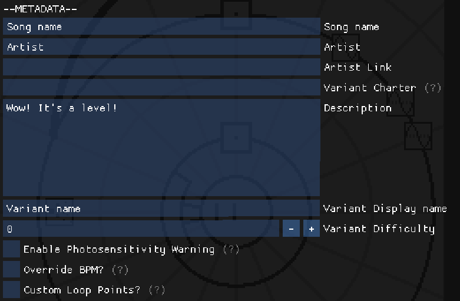

Below the METADATA section are the Variant Specific,  BG and OTHER sections, which let you choose a

song select background image* and miscellaneous properties.

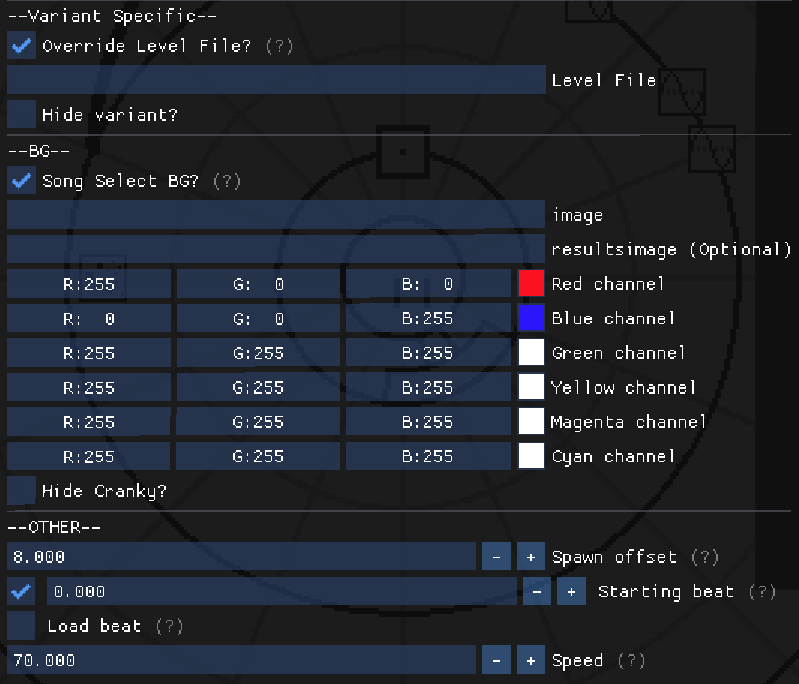

\*BG images must fit the eight-channel palette, which is explained further in the decorations guide.

---

## Issues with Importing Songs

Can’t get your song imported? You’ve come to the right place.

Some things to check:

Is your file in a supported format? (Hint: if it’s an MP3, those are not supported!)

- Ok, but is it actually in a supported format?

{/*THE END*/}

- Many converters and downloaders can give broken files that are actually other formats in disguise!
- For downloading, [https://cobalt.tools/](https://www.google.com/url?q=https%3A%2F%2Fcobalt.tools%2F&sa=D&source=editors&ust=1795465856745582&usg=AOvVaw0uoJgrYegZUe8v05vq0rrF) is known to work.
- For converting, you can use [https://www.audacityteam.org/](https://www.google.com/url?q=https%3A%2F%2Fwww.audacityteam.org%2F&sa=D&source=editors&ust=1795465856745666&usg=AOvVaw3DGZkceULE9XsmFp30X8xL)

{/*THE END*/}

- Do you have file extensions turned on?

{/*THE END*/}

- If you don’t, here is a tutorial: [https://www.howtogeek.com/205086/beginner-how-to-make-windows-show-file-extensions](https://www.google.com/url?q=https%3A%2F%2Fwww.howtogeek.com%2F205086%2Fbeginner-how-to-make-windows-show-file-extensions&sa=D&source=editors&ust=1795465856745790&usg=AOvVaw1beSkRqHM7ASuf9dn1NKyr)

{/*THE END*/}

- Now that you have file extensions turned on, does your file only have one extension?

{/*THE END*/}

- If your file is named “song.ogg.ogg” or something similar, you need to change it to just be “song.ogg”

{/*THE END*/}

- Is your file named properly, and is the file set to that name in your play song event?

{/*THE END*/}

- In the play song event, you need to put the file name, including the extension.

{/*THE END*/}

- Have you set your BPM and offset correctly?

{/*THE END*/}

- If you are having trouble finding the BPM of your song, please ask in the discord. Starting your level with the wrong BPM will make your level out of sync and bad to play, and there is no way to fix it other than starting the level over, so please make sure you have it correct!!

## Placing Notes &amp; Events

Select your preferred note/event type in the event palette

and click on the desired position in the timeline.

|                                                 |
|-------------------------------------------------|
| 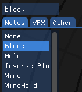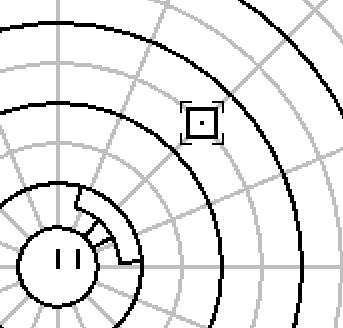 |

Overlapping events will bring up a prompt asking which should be selected.

Remember: you can also adjust your angle snap to place events along a greater range of angles, or manually enter angle &amp; time positions in the Event editor.

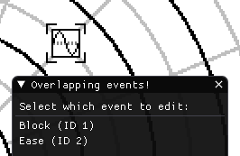

Events with easings that occur at the same time for the same object (ex. a decoration with separate X and Y easings) need to be ordered using the “order” function to work properly.

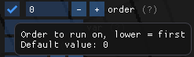

The next section will go over the different note &amp; event types you can select by default, and what their functions are. Other events may not be included but still usable by entering their respective ID in the text field of the Event palette.

---

### Note Types

|               |                          |                                                           |
|---------------|--------------------------|-----------------------------------------------------------|
| Block         |    | The most basic note.                                      |
| Hold          |   | Hold notes that the paddle must follow.                   |
| Inverse Block |  | Notes that must be hit on the back of the paddle.         |
| Mine          |   | Notes the player must avoid.                              |
| Minehold      |  | The same as mines, but occupying an entire range of time. |
| Bounce        |   | Notes that must be hit multiple times                     |
| Side          |   | Notes that must be hit on the side of the paddle.         |
| Extra Tap     |   | Notes that require a button input.                        |
| Trace         |   | A decorative hold                                         |

---

### VFX Event Types

|                  |                          |                                                                 |
|------------------|--------------------------|-----------------------------------------------------------------|
| Ease             |   | Can set easable adjustments for all applicable variables.*      |
| Hall of Mirrors  |  | Adds a frame-smear effect.                                      |
| Noise            |  | Adds a noise effect.                                            |
| Set color        | 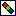   | Allows you to change color values.                              |
| Set BG color     |  | Sets the channel the BG is colored to.                          |
| Outline          |   | Adds a colored outline to Cranky, notes, and other UI elements. |
| Decoration       |   | Adds, colors, and transforms decorations.\**                    |
| Edit Player      |  | Changes Cranky’s expression and properties.                     |
| Toggle Particles |   | Enables or Disables the particle effects for all notes.         |
| Text Decoration  |   | Draws text on screen                                            |

\*A list of easable variables is provided later.

\*\*A more detailed section on decorations is included later in this guide.

---

### Other Event Types

|              |                                                                                                                                                                                                                                                                 |                                                                                                              |
| ------------ | --------------------------------------------------------------------------------------------------------------------------------------------------------------------------------------------------------------------------------------------------------------- | ------------------------------------------------------------------------------------------------------------ |
| None         | N/A                                                                                                                                                                                                                                                             | Does not place events. <br></br>Helpful when you need to only select existing events.                         |
| Play song    |                                          | Plays a selected audio file as the song. Has a built-in BPM field.**                                         |
| Play sound   |              | Plays a selected audio file as a sound effect. THIS IS NOT THE SAME AS THE PLAY SONG EVENT.                  |
| Set BPM      |                              | Set the BPM. Good for mid-track tempo changes.                                                               |
| Show Results |                          | A “finish level” event that shows the results screen. Remember to add one of these!**                        |
| Run tag      |                                                  | Runs the designated tag.                                                                                     |
| Edit Paddles |  | Changes the number and properties of Cranky’s paddles                                                        |
| Set Boolean  |                              | Enables/disables boolean variables.*                                                                         |
| Bookmark     |                                                  | Places bookmarks that can be named and tagged with descriptions, for sorting or sectioning parts of a chart. |

\*A list of booleans is included later in this guide.

\*\*Only one of these events can be placed in a level.

---

## Editor Utilities

### Hotkeys

Full list of hotkeys available inside of the editor

|   |   |   |
|---|---|---|
||S|Save level|
||P|Play from current beat|
|Ctrl|P|Play from start of level|
|Ctrl|G|Jump to beat|
|Ctrl|I|Open level properties panel|
|Shift|Click|Multiselect (places markers for start & end of selection)|
|Ctrl|C|Copy & paste<br></br>(only currently works with multiselect)|
|Ctrl|V|
|Ctrl|Scroll|Zoom in+out|
||R Click|Delete event|
||🠈🠊|Change selected event’s angle|
||🠉🠋|Change selected event’s time|
||Alt|View section timeline (mark sections with the Bookmark event)|
|Alt|🠊|Skip to end of current section|
|Alt|🠈|Skip to start of current section|
|Ctrl|R|Reset editor layout|

### Math parser

Inputting calculations into the number fields of events will make the calculations for you.

example:

| Typing this into any numerical field and pressing enter… |   | …will make the calculation for you |
|----------------------------------------------------------|---|------------------------------------|
| 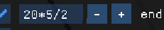                                 |   | 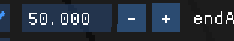            |

You can also use certain mathematical functions to make calculations easier.

Available functions:

| sin(x) | cos(x) | tan(x)  | asin(x)  | acos(x)    | atan(x)     | floor(x)                         | ceil(x)                          |
|--------|--------|---------|----------|------------|-------------|----------------------------------|----------------------------------|
| Sine   | Cosine | Tangent | Arc sine | Arc cosine | Arc tangent | Mathematical floor (rounds down) | Mathematical ceiling (rounds up) |

| abs(x)         | log(x)    | log10(x)          | exp(x)        | rad(x)             | deg(x)             | rand(x,y)                 | lerp(x,y,t)                               |
| -------------- | --------- | ----------------- | ------------- | ------------------ | ------------------ | ------------------------- | ----------------------------------------- |
| Absolute value | Logarithm | Logarithm base 10 | Exponent (ex) | Degrees to radians | Radians to degrees | Random number from x to y | Linear interpolation: <br></br>x + (y-x)*t |

In the editor you would replace x,y or t with a number of your choosing (i.e. inputting sin(20) will give you 0.913 )

Also these variables are available:

| pi              | rand                      | cx                | cy                |
|-----------------|---------------------------|-------------------|-------------------|
| The value of pi | Random number from 0 to 1 | Replaced with 300 | Replaced with 180 |

# Variables List

## Booleans

| Variable name               | Default value | Description                                                                                                                                                                     |
| --------------------------- | ------------- | ------------------------------------------------------------------------------------------------------------------------------------------------------------------------------- |
| `vfx.hwaves.flip`           | `false`       | Should the amplitude of the waves flip every frame?                                                                                                                             |
| `vfx.notesFollowPlayer`     | `true`        | Should notes move as well when the player is moved?                                                                                                                             |
| `vfx.drawCombo`             | `true`        | Should the combo be displayed?                                                                                                                                                  |
| `vfx.drawAccuracy`          | `true`        | Should accuracy be displayed? (Expanded HUD only)                                                                                                                               |
| `vfx.drawSongTitle`         | `true`        | Should the song’s title be displayed? (Expanded HUD only)                                                                                                                       |
| `vfx.drawDifficulty`        | `true`        | Should the chart’s difficulty be displayed? (Expanded HUD only)                                                                                                                 |
| `vfx.drawUI`                | `true`        | Should the UI be displayed?  (Has priority over other draw variables)                                                                                                           |
| `vfx.ignoreNoiseCorrection` | `false`       | Changes the way Noise Chance is calculated.                                                                                                                                     |
| `newHoldDetection`          | `true`        | Disabling returns the demo behaviour for holds.                                                                                                                                 |
| `vfx.onTopUI`               | `true`        | If set to false, UI gets affected by VFX.                                                                                                                                       |
| `p.disableCostume`          | `false`       | If set to true, makes the player no longer wear a costume.                                                                                                                      |
| `vfx.darkness.enabled`      | `false`       | Enables the darkness effect found in BEATROCK.                                                                                                                                  |
| `vfx.holdCulling`           | `true`        | Related to the optimisation of holds, mineholds and traces where the end of the hold is too far off screen. Only to be disabled in very niche cases where it breaks your level. |
| `vfx.holdCullExtend`        | `true`        |                                                                                                                                                                                 |

## Easables

### Gameplay / Note related eases
| Variable name             | Default value | Description                                                         |
| ------------------------- | ------------- | ------------------------------------------------------------------- |
| `scrollSpeed`             | `1`           | Multiplies the scroll speed set in the level properties.            |
| `extraHoldLeniency`       | `0`           | Adds to the leniency timer for holds. (cannot be negative)          |
| `noteRadius`              | `9`           | How big the hit radius for notes are. (not the same as scale)       |
| `objectRotation`          | `0`           | Rotates all of the notes by a certain rotation.                     |
| `vfx.noteXScale`          | `1`           | Scales notes horizontally.                                          |
| `vfx.noteYScale`          | `1`           | Scales notes vertically.                                            |
| `vfx.noteXSkew`           | `0`           | Skews notes horizontally.                                           |
| `vfx.noteYSkew`           | `0`           | Skews notes vertically.                                             |
| `vfx.noteRotate`          | `0`           | Rotates the notes.                                                  |
| `additionalHoldWidth`     | `0`           | Adds width to the connection part of the hold.                      |
| `vfx.extraTapWidth`       | `2`           | Default line thickness for extraTaps.                               |
| `vfx.extraTapWidthPulse`  | `3`           | Line thickness for extraTaps on pulses.                             |
| `vfx.tapPulsePeriod`      | `1`           | How often taps should pulse.                                        |
| `vfx.tapPulseStrength`    | `1.5`         | How much taps should grow by on pulses.                             |
| `vfx.tapWidthPulse`       | `3`           | Line thickness for taps on pulses.                                  |
| `vfx.angleTwist.offset`   | `0`           | How much angles should be offset by at the specified distance.      |
| `vfx.angleTwist.distance` | `8`           | How far away angles should be offset from.                          |
| `vfx.holdSegmentLimit`    | `0`           | How many segments every hold should have (0 disables this).         |
| `vfx.holdDistanceLimit`   | `700`         | Distance after which hold culling takes effect..                    |
| `noteVolume`              | `1`           | Can be used to make notes quieter. (does not accept values above 1) |

### Visual effects

| Variable name                                                                                                                                                            | Default value | Description                                               |
| ------------------------------------------------------------------------------------------------------------------------------------------------------------------------ | ------------- | --------------------------------------------------------- |
| `vfx.hglitch.strength`                                                                                                                                                   | `0`           | How many pixels in either direction hglitch can shift.    |
| `vfx.hglitch.resolution`                                                                                                                                                 | `3`           | How tall in pixels hglitch "chunks" should be.            |
| `vfx.hwaves.strength`                                                                                                                                                    | `0`           | Controls the amplitude of the screen waves.               |
| `vfx.hwaves.period`                                                                                                                                                      | `16`          | Controls the period of the screen waves.                  |
| `vfx.hwaves.offset`                                                                                                                                                      | `0`           | How offset the waves should be.                           |
| `vfx.hwaves.offsetDelta`                                                                                                                                                 | `0`           | How much the offset should be changed every frame.        |
| *NOTE: For all vfx.hwaves and vfx.hglitch easables, there<br></br>are corresponding vfx.vwaves and vfx.vglitch easables.<br></br>These control the effects for the vertical axis.* |               |                                                           |
| `vfx.pixelate`                                                                                                                                                           | `1`           | How pixelated the screen should be.                       |
| `vfx.bgNoise`                                                                                                                                                            | `0`           | Allows easing of the Noise event’s “chance” variable.     |
| `vfx.bgNoiseTimeStep`                                                                                                                                                    | `0`           | Changes how fast background Noise updates.                |
| `vfx.bgNoisePixelate`                                                                                                                                                    | `1`           | Pixelates background Noise.                               |
| `vfx.hueShift`                                                                                                                                                           | `0`           | Shifts the hue of the level by a certain amount.          |
| `vfx.flashStrength`                                                                                                                                                      | `0`           | How much should the screen flash be visible at any point. |
| `vfx.flashColor.r`                                                                                                                                                       | `0`           | Adjusts the red value of the flash easable.               |
| `vfx.flashColor.g`                                                                                                                                                       | `0`           | Adjusts the green value of the flash easable.             |
| `vfx.flashColor.b`                                                                                                                                                       | `0`           | Adjusts the blue value of the flash easable.              |
| `vfx.fisheye.strength`                                                                                                                                                   | `1`           | How much should the fisheye effect affect the screen.     |
| `vfx.fisheye.x`                                                                                                                                                          | `1`           | Adjusts the fisheye’s x position.                         |
| `vfx.fisheye.y`                                                                                                                                                          | `1`           | Adjusts the fisheye’s y position.                         |
| `vfx.fisheye.sx`                                                                                                                                                         | `1`           | Scales the fisheye horizontally.                          |
| `vfx.fisheye.sy`                                                                                                                                                         | `1`           | Scales the fisheye vertically.                            |
| `vfx.fisheye.scale`                                                                                                                                                      | `1`           | Controls the fisheye shader.                              |
| *(these following eases require `vfx.darkness.enabled` to be<br></br>set to true, and are related to the darkness found in BEATROCK)*                                         |               |                                                           |
| `vfx.darkness.noteLightRadius`                                                                                                                                           | `24`          | Controls the radius of light around the notes.            |
| `p.lightRad`                                                                                                                                                             | `64`          | Controls the radius of light around cranky.               |
| `vfx.darkness.color`                                                                                                                                                     | `0`           | Controls the color channel for the darkness.              |

### Canvas related eases
*Eases related to the properties of the screen*

| Variable name                                                                                                                                                                                                                     | Default value | Description                                              |
| --------------------------------------------------------------------------------------------------------------------------------------------------------------------------------------------------------------------------------- | ------------- | -------------------------------------------------------- |
| `vfx.canvPos.x`                                                                                                                                                                                                                   | `300`         | What X position the main game canvas should be drawn at. |
| `vfx.canvPos.y`                                                                                                                                                                                                                   | `180`         | What Y position the main game canvas should be drawn at. |
| *NOTE: In almost every case, it is preferable to use<br></br>p.x and p.y instead. These manipulate the player<br></br>position directly, instead of moving the canvas,<br></br>which prevents the game area from being “cropped”* |               |                                                          |
| `vfx.canvPos.r`                                                                                                                                                                                                                   | `0`           | How many degrees to rotate the main game canvas.         |
| `vfx.canvPos.sx`                                                                                                                                                                                                                  | `1`           | Scales the main game canvas horizontally.                |
| `vfx.canvPos.sy`                                                                                                                                                                                                                  | `1`           | Scales the main game canvas vertically.                  |
| `vfx.canvPos.ox`                                                                                                                                                                                                                  | `300`         | What X offset the main game canvas should be drawn at.   |
| `vfx.canvPos.oy`                                                                                                                                                                                                                  | `180`         | What Y offset the main game canvas should be drawn at    |
| `vfx.canvPos.kx`                                                                                                                                                                                                                  | `0`           | Skews the main game canvas horizontally.                 |
| `vfx.canvPos.ky`                                                                                                                                                                                                                  | `0`           | Skews the main game canvas vertically.                   |
| *NOTE: For all vfx.canvPos easables, there is<br></br>a corresponding vfx.homCanvPos easable.<br></br>These control the position of the<br></br>Hall of Mirrors effect canvas.*                                                   |               |                                                          |

### Player related eases
*Eases related to how cranky is drawn.*

| Variable name         | Default value | Description                                                                          |
| --------------------- | ------------- | ------------------------------------------------------------------------------------ |
| `p.x`                 | `300`         | Cranky’s X position.                                                                 |
| `p.y`                 | `180`         | Cranky’s Y position.                                                                 |
| `p.paddleDistance`    | `31`          | The distance between Cranky and the Paddle.                                          |
| `p.lookYOffset`       | `0`           | Changes where Cranky’s eyes are drawn on the Y axis.                                 |
| `p.lookXOffset`       | `0`           | Changes where Cranky’s eyes are drawn on the X axis.                                 |
| `p.lookRadius`        | `6`           | The radius where Cranky’s eyes will follow your cursor.                              |
| `p.outlineColor`      | `1`           | Changes Cranky’s outline color channel. (0,1,2,3,4,5,6,7)                            |
| `p.fillColor`         | `0`           | Changes Cranky’s fill color channel. (0,1,2,3,4,5,6,7)                               |
| `p.faceColor`         | `-1`          | Changes Cranky’s face color channel. -1 shows original colors.  (-1,0,1,2,3,4,5,6,7) |
| `p.bodyRadius`        | `20`          | The radius that Cranky’s body is drawn in.                                           |
| `p.drawScale`         | `1`           | The scale at which Cranky is drawn.                                                  |
| `p.layer`             | `0`           | Changes which layer Cranky is drawn on.                                              |
| `p.extend`            | `0`           | Extends Cranky’s body and Paddle.                                                    |
| `p.ouchTime`          | `15`          | How long the pulse from missing a note lasts.                                        |
| `p.lineWidth`         | `2`           | How thick Cranky’s outlines are in px.                                               |
| `p.maxBodyPulse`      | `0.2`         | How strong the pulse from missing a note is.                                         |
| `p.feedbackAmplitude` | `2.5`         | How strong the feedback is for hitting with the Paddle.                              |
| `p.feedbackDuration`  | `4`           | How long the feedback for hitting with the Paddle lasts.                             |
| `p.faceScale`         | `1`           | What is the scale of the face sprite?                                                |
| `p.faceScaleX`        | `1`           | Scales the face sprite horizontally.                                                 |
| `p.faceScaleY`        | `1`           | Scales the face sprite vertically.                                                   |
| `p.faceRotation`      | `0`           | What is the rotation of the face sprite?                                             |

### UI related eases

| Variable name                                                  | Default value | Description                                                                                                                                                                          |
| -------------------------------------------------------------- | ------------- | ------------------------------------------------------------------------------------------------------------------------------------------------------------------------------------ |
| `vfx.comboX`                                                   | `0`           | What X position the combo counter should be drawn at.                                                                                                                                |
| `vfx.comboY`                                                   | `0`           | What Y position the combo counter should be drawn at.                                                                                                                                |
| `vfx.accuracyX`                                                | `0`           | What X position the accuracy should be drawn at.                                                                                                                                     |
| `vfx.accuracyY`                                                | `0`           | What Y position the accuracy should be drawn at.                                                                                                                                     |
| `vfx.songNameX`                                                | `0`           | What X position the song’s name should be drawn at.                                                                                                                                  |
| `vfx.songNameY`                                                | `0`           | What Y position the song’s name should be drawn at.                                                                                                                                  |
| `vfx.difficultyX`                                              | `0`           | What X position the chart’s difficulty should be drawn at.                                                                                                                           |
| `vfx.difficultyY`                                              | `0`           | What Y position the chart’s difficulty should be drawn at.                                                                                                                           |
| `vfx.uiColor`                                                  | `1`           | Changes the color channel the UI uses. (0,1,2,3)<br></br>WARNING! Do not use duration with this variable.                                                                                 |
| *NOTE: All UI position variables<br></br>only affect Expanded HUD.* |               |                                                                                                                                                                                      |
| `vfx.glitchUIElements`                                         | `0`           | Allows the UI elements to cycle through random strings every frame.<br></br>0 - No UI glitches<br></br>1 - Combo<br></br>2 - Combo and Accuracy<br></br>3 - Combo, Accuracy, and Song Name<br></br>4 - All UI |

---

# Decorations 101

The following section will detail all the essential information needed in order to use the decoration event starting from the basics of colors, to single image decorations, to animated ones.

## Color channels 101

The way the game currently operates, is that it only allows up to 8 colors to be present on screen at any given moment. The way these colors are handled are through 8 color channels indexed from 0-7. Each index is responsible for one color and are as following:

|                          |                          |                          |                         |
|--------------------------|--------------------------|--------------------------|-------------------------|
| Channel 0                | Channel 1                | Channel 2                | Channel 3               |
| 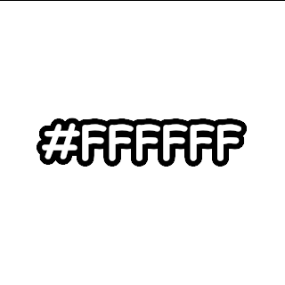 | 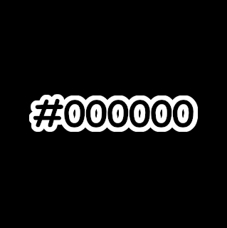 | 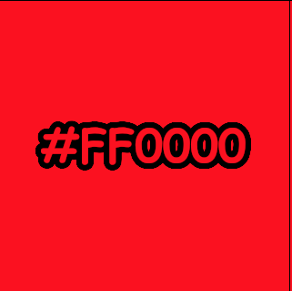  | 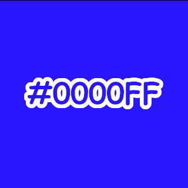 |
| Channel 4                | Channel 5                | Channel 6                | Channel 7               |
| 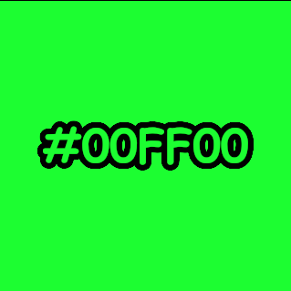  | 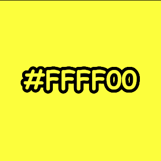 | 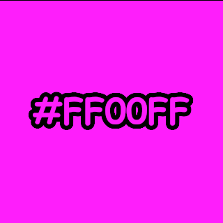 | 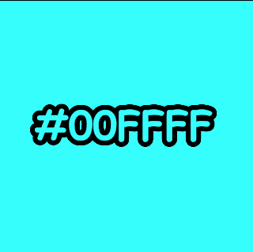  |

Image credits to @itsdakirby69 and @wisnia465

i.e. if you decide to change channel 1 using a Set Color event it will change everything on screen that is black to that color,  including cranky’s and all the note outline colors.

---

## Still Decorations

### Part 1: The basics

So, you want to add an image into your game? You are going to need to place a “decoration” event into your level. It has a lot of options and we’ll go through the ones you need one by one. For a full list of explanations of the options in the decoration event, check the Events section of this guide.

For now, just know that whichever one of these you leave unchecked, will not apply to the decoration you’re creating.

So, now that you’ve got a decoration event in your level, you must initialise your decoration.

In this initial creation event you are required to fill out the “id”, but you might want to fill out the “sprite“  field as well (don’t forget to add the file extension i.e. ”.png” to the end of the sprite field ).  If you don't specify anything for the sprite, a little cat sprite will appear.

You could also mess with x or y, in order to give it a position on the screen.

The game’s coordinates range from 0-600 from left to right in the horizontal direction (X), and from 0-360 from top to bottom in the vertical direction (Y). Meaning  (0,0) is at the top left  of the screen.

By default the image will be placed at x=300,y=180 which is the center of the screen and also where cranky is positioned

Example:

|                                                  |                               |
|--------------------------------------------------|-------------------------------|
| This configuration (all other fields left blank) | Will give this in game result |
| 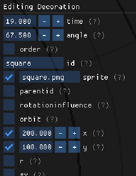                         | 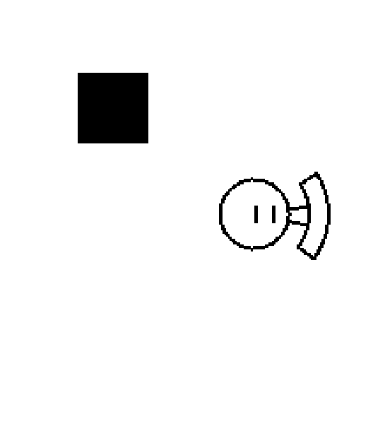       |

Keep in mind that by default, your image is placed using its top left corner as reference.

 To change this (i.e. place an image using its center) you must change the “ox” and “oy” properties (which stand for offset x/y). This moves the “center point” to be the amount of pixels you specify. So for our 40x40 pixels square image, setting ox and oy to 20 will make it centered.

### Part 2: Colorful images

Now what if the image of your liking has color? You will have to first make it operate within the 8 color channel limit. Meaning  every pixel in your image must match one of the 8 colors specified above.  If it’s even a single RGB value off of what is necessary, the game will replace it with the black and purple error texture.

|                                                           |                                        |                                         |
|-----------------------------------------------------------|----------------------------------------|-----------------------------------------|
| Example of an incorrectly colored image appearing in-game | The same image colored black (#000000) | The same image colored blue (#0000FF) * |
| 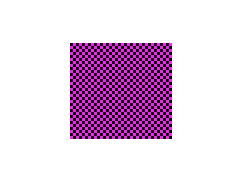                                   |                |                 |

\*unless specified, colors other than black and white will appear gray or black by default. In order to give your images different colors you must use Set Color events, which will change the appearance of the color in game into the color you specify.

Be extra mindful of anti-aliasing!

|                                                        |                                                                             |
|--------------------------------------------------------|-----------------------------------------------------------------------------|
| Line with anti-aliasing (left) vs line without (right) | Line with anti-aliasing (left) vs line without (right) inside of beatblock* |
| 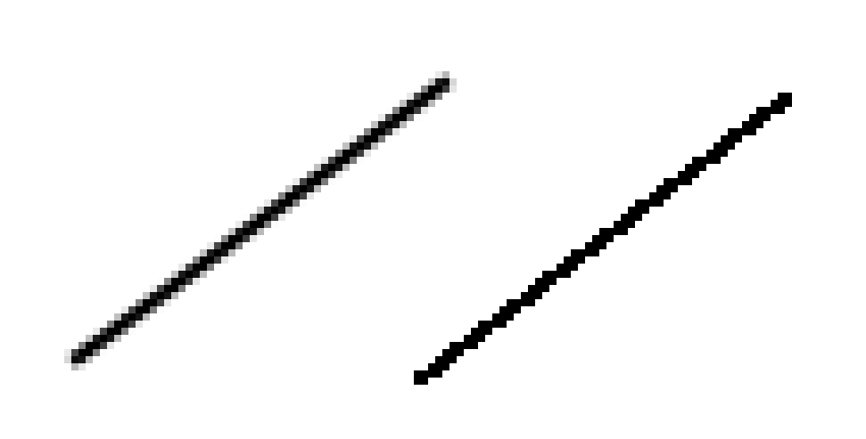                               | 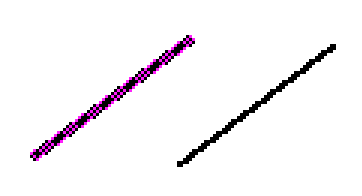                                                    |

\*The one with anti-aliasing will not work in-game because some of its pixels aren’t pure black!

## Animated Decorations

### Part 1: Basic movement

Now that you’ve got a still image into your game, you can begin to move it around.

How you do this is by placing another decoration event (after the first one has been declared) that has the same id as you had in the event creating  the decoration.

Now whichever field you decide to alter will change the decorations properties, and whichever one you leave unchecked, will remain unchanged.

Let’s do another example with the square from earlier:

|                                                                                                 |                               |
|-------------------------------------------------------------------------------------------------|-------------------------------|
| This configuration (the event one beat before, is the creation event from the previous section) | Will give this in game result |
| 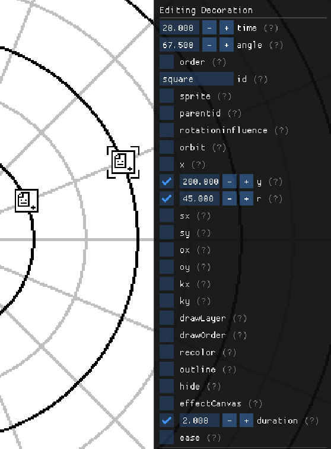                                                                         | 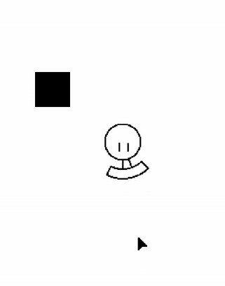      |

Notice how the duration being 2 (beats) means that it’ll take that long for the decoration to go from its original position to the new one.  
Also noteworthy is how the square is rotating in a “weird way” ; this is caused by the fact that  we haven’t specified an offset for our decoration

### Part 2: Complex animations

Now, what if you want to add an animation into your game that has multiple states? (i.e. a character’s running animation). Well you can put them into a spritesheet and use the in game animation system!

Animated decorations (or decos) contain two parts- the spritesheet (.png format) and a .json file. These two files must share the same name  to properly function.

|                          |
|--------------------------|
| 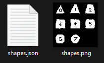 |

.json files have the following info inside them:

- Width &amp; height:  determines how big an individual frame is in pixels.
- fps:  the default frames per second for all states. When an fps value isn’t included in a state, this is what it’ll default to. If this value isn’t included, it’ll default to 60 fps.
- frames:  how many frames are in the sheet. While not required, this can be useful if there are any blank spots at the end of the sheet.

{/*THE END*/}

- Frames are zero-indexed, so these are counted in the deco event as  
  0, 1, 2, etc.
- If the frame number specified is larger than the amount of frames in your image the game will crash!

{/*THE END*/}

- states:  used to set toggleable animations for a sprite with multiple expressions and are optional to have in your json

So in our specific example:

- A singular frame is 32 by 32 pixels, so that’s what we put into “width” and “height”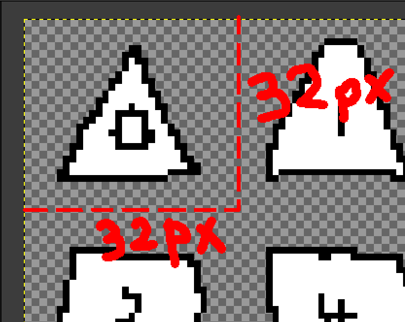
- “Fps” is just how fast we want the animation to run by default, so we arbitrarily choose 12
- And there are 8 total frames (bottom right is empty), so that’s what we add as “frames”
- States are optional, but here is how you would go about adding one. (Double check that all your frame numbers are within bounds (Between 0 and 7 in this case) otherwise your game will crash!)

The contents of the shapes.json file:
```json
{
  "width": 32,
  "height": 32,
  "fps": 12,
  "frames": 8,
  "states": [
    {
      "name": "squareTriangleLoop",
      "frames": [
        0,
        1,
        2,
        3,
        4,
        3,
        2,
        1
      ],
      "fps": 8,
      "loop": true
    }
  ]
}
```

{/* TODO */}

Deco animations are controlled via the “sprite” property.

Meaning, in the “sprite” field you would add your filename, followed by one of these shortcuts, which are detailed below:

.png

Static PNG deco.

!state

Plays a state given in the deco’s .json

#frame

Takes numerical input, displays relevant frame (zero-indexed.)

#RANDOM

and

#TRUERANDOM

Displays a random frame

(#RANDOM prevents the same from from being picked twice in a row)

!state@fps

Plays a state at specified fps number and overrides .json fps.

@fps

Plays all frames at specified fps number. Good for decos with only one animation state.

!state#frame

Plays a state starting from the specified frame number.

!state#frame@fps

These can also be combined, meaning you can play a state from a specified frame number, at a certain fps number.

Examples:

|                         |                          |                           |
|-------------------------|--------------------------|---------------------------|
| shapes.png              | shapes@4                 | shapes!squareTriangleLoop |
| 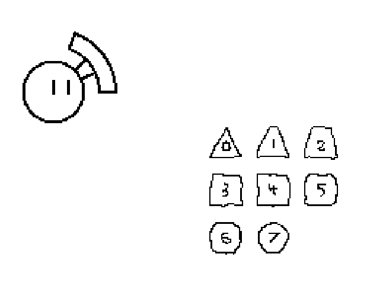 | 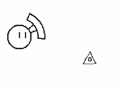 | 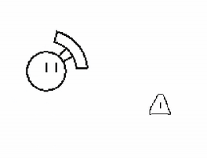  |

|                         |                              |
|-------------------------|------------------------------|
| shapes#6                | shapes!squareTriangleLoop@30 |
| 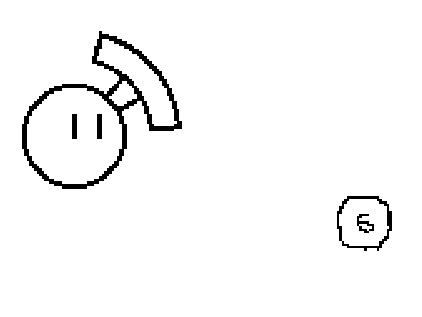 | 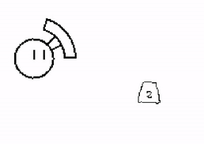     |

---

## The Effect Canvas

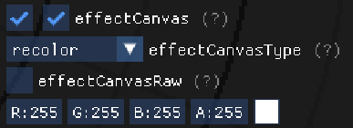

Disclaimer: This topic is slightly advanced in nature and is in no way necessary to understand in order to use decorations effectively!

### Part 1:  recolor effect canvas

What the recolor effect canvas accomplishes, is that it turns your inputted image into a mask that swaps the color channels  beneath it, depending on how you have configured it. The example below only shows a swap between the first four channels.

For example:

|                                          |   |                                                                       |
|------------------------------------------|---|-----------------------------------------------------------------------|
| A configuration like this:               |   |                                                                       |
| 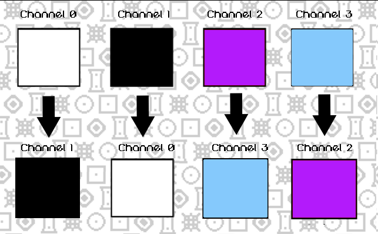                 |   |                                                                       |
|                                          |   |                                                                       |
| Would give the following in game result: |   |                                                                       |
| Before:                                  |   | After: (the largest square is the decoration using the effect canvas) |
| 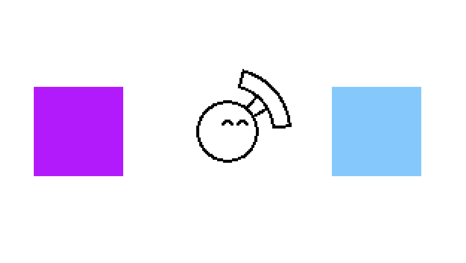                  |   | 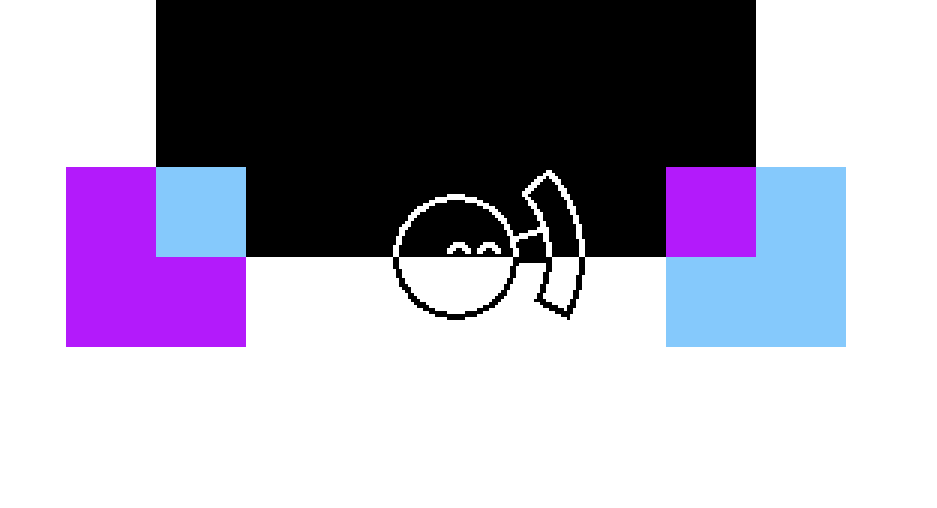                                              |

To achieve this effect, the game takes the full hex code (#000000 to #FFFFFF) for the color of each individual pixel in the original image  and converts it into binary (i.e. a hex code of #FAC4C1 will become “1111,1010,1100,0100,1100,0001”) and then it splits said binary number into eight (“111110101100010011000001” → \[111],\[110],\[101],\[100],\[010],\[011],\[000],\[001]) and then using those numbers, decides which channels need to be swapped. In this example:

Channel 7:  \[111] which is 7 in decimal →  Channel 7 gets swapped with channel 7 (no effect)

Channel 6:  \[110] which is 6 in decimal →  Channel 6 gets swapped with channel 6 (no effect)

Channel 5:  \[101] which is 5 in decimal →  Channel 5 gets swapped with channel 5 (no effect)  
Channel 4:  \[100] which is 4 in decimal →  Channel 4 gets swapped with channel 4 (no effect)  
Channel 3:  \[010] which is 2 in decimal →  Channel 3 gets swapped with channel 2↰

Channel 2:  \[011] which is 3 in decimal →  Channel 2 gets swapped with channel 3↲

Channel 1:  \[000] which is 0 in decimal →  Channel 1 gets swapped with channel 0↰

Channel 0:  \[001] which is 1 in decimal →  Channel 0 gets swapped with channel 1↲

You don't need to make this calculation by hand every time, you can use [this calculator spreadsheet](https://www.google.com/url?q=https%3A%2F%2Fdocs.google.com%2Fspreadsheets%2Fd%2F1VEf9EGsu3EnWQlcxYZNLBg87FVK0iqRm9I_L9BEL4JI%2Fedit&sa=D&source=editors&ust=1795465856818314&usg=AOvVaw09HbB20Eqk_n8DFvtSrvPL) (made by \_play\_) and then use the color value it tells you!

Now you can either input the calculated color into the in game color picker, which will recolor your entire image to be said color, and do the swaps you want (disclaimer: currently the in game color picker does not work properly) or alternatively if you want more control you can color your original image with the calculated color manually and check the effectCanvasRaw setting.

### Part 2:  displace effect canvas

Similarly, the displace effect canvas also acts as a mask, however instead of affecting the color, it displays the pixel that is that amount of pixels to the left/right or up/down.

This is calculated using the images red and green values.  
The values Red = 128 and Green = 128 mean that no displacement is happening, and Red=118 and G=128 would sample 10 pixels to the left of where it would normally sample.

Since the initial value is 128, you  can only sample  in a range of 128 pixels to the left / up (until red/green reach a value of 0) and 127 pixels right / down (until red/green reach a value of 255)

Make sure the alpha value you’re using is always 255, if it’s less than that the displace won’t have the desired effect.

Again, you don't need to make this calculation by hand you can use [this calculator spreadsheet](https://www.google.com/url?q=https%3A%2F%2Fdocs.google.com%2Fspreadsheets%2Fd%2F1VEf9EGsu3EnWQlcxYZNLBg87FVK0iqRm9I_L9BEL4JI%2Fedit&sa=D&source=editors&ust=1795465856819223&usg=AOvVaw0HudodEheYl82l81qSe0k1) (made by \_play\_) and then use the color value it tells you, either by inputting it into the in-game color picker (disclaimer: color picker is currently broken) or manually recoloring your original image (and checking effectCanvasRaw)

Examples:

|                            |   |   |                                        |
|----------------------------|---|---|----------------------------------------|
| This effect in Lucky Break |   |   | The blur effect in the level DAMOCLISM |
| 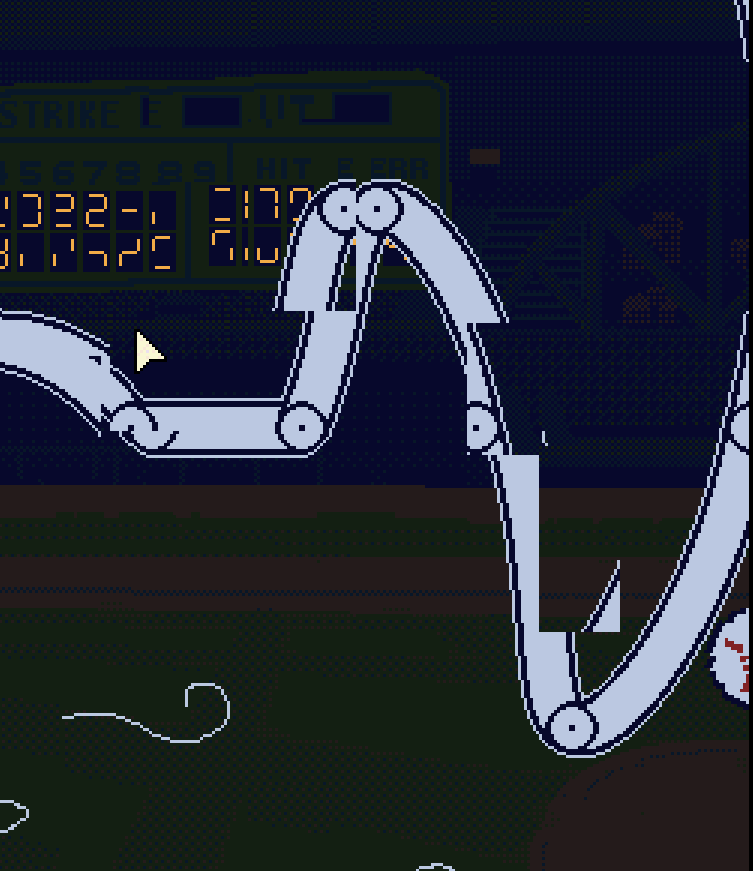   |   |   | 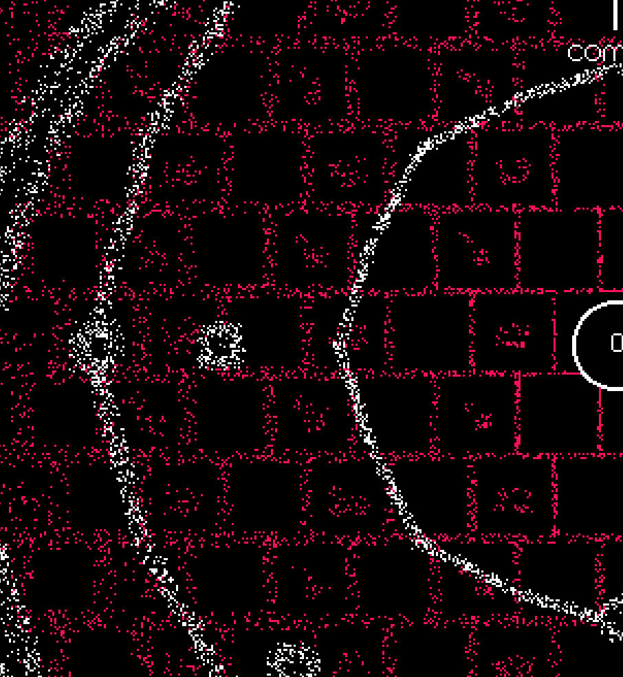               |

## 3D Decorations

“Show advanced events” setting required for these events

In order to use 3d decorations inside of your level you need two things:  

A Camera 3D event, and a Decoration 3D event.

The Decoration 3D event will require a texture and a model. The model needs to be a .obj file and the texture must still abide by the 8 color channel rules.

Once a model is placed within the world, the camera captures it, and the 2d camera feed is what is shown in the background.

With the default camera placement ( meaning the camera is positioned at (0,0,0) and is looking at (0,1,0) ), the X axis is responsible for moving the object right (positive) and left (negative).

The Y axis is responsible for moving the object further away (positive) and behind the camera (negative).

Lastly the Z axis is responsible for moving the object up (positive) and down (negative)

i.e.

|                                                                                                                              |                                                                                                                            |   |
|------------------------------------------------------------------------------------------------------------------------------|----------------------------------------------------------------------------------------------------------------------------|---|
| The following events inside beatblock (the model is the blender default cube, with a texture coloring each side differently) | Produce the following result inside of beatblock (there is a third event changing the rotation for demonstration purposes) |   |
| 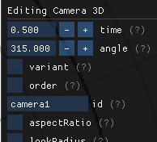                                                                                                     | 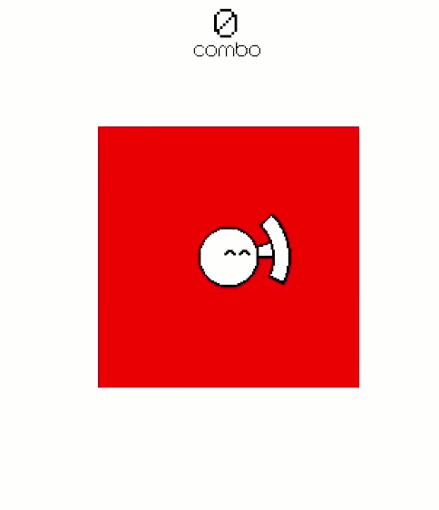                                                                                                   |   |
| 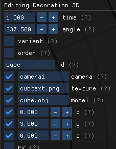                                                                                                       |                                                                                                                            |   |

# Rhythms 101

- Tempo

Tempo dictates how fast a song is, and is generally measured in beats per minute (BPM.) Beats and measures are the main units we’ll be referring to for this crash course.

Not all tracks will have perfect tempo. Some may change suddenly or gradually (accelerando/ritardando,) and live performances will fluctuate. You can utilize the Set BPM event to account for this by making minor adjustments.

- Time signatures and beats

Time signatures are shown as fractions. The top number tells you how many beats are in one measure. The bottom number tells you which type of note is considered one beat. Most songs are commonly in 4/4- four beats per measure, with a 4th/quarter note being considered “one beat.” In essence, 4/4 means four quarter notes per measure. “Bars” are another name used to refer to measures.

By default, the editor’s timeline is set up in 4/4 with groups of 4 beats. However, changing Snap and BPM (as well as taking advantage of the Bookmark event) can help you chart in more uncommon time signatures like 7/8 or 5/4.

- Note lengths (8th/16th/triplets/swing)

Besides quarter notes, we have other common notes such as 8th and 16th notes. Much like fractions, each is half the length of the previous one (2 16ths in an 8th, 2 8ths in a quarter.) Conversely, half notes and whole notes are twice the length of each previous note (2 quarters in a half, 2 halves in a whole.) The different Beat interval options in the level editor’s Snap window allow you to place notes and events along these beats.

Triplets still fit this fractional idea, but rather than doubling or halving it occupies a third of a note’s length. Other variants of a tuplet may split notes into different fractions (ex. quintuplets as 1/5th.) Since Beatblock uses decimals to mark beats, you can manually type in converted fraction values for uncommon tuplets.

Swing rhythms make the spacing between notes irregular- think of it as shifting every other note a set amount. 16th note swing and triplet swing are both commonly seen.

- Onbeats/offbeats &amp; syncopation

We can take a 4/4 measure with four quarter notes and assign each a number (1 through 4.) Our odd numbers are “onbeats,” and our even numbers are “offbeats.” Think of a basic kick &amp; snare rhythm where our kick drum hits on the 1 and 3, while our snare drum hits on the 2 and 4.

You may also hear the first beat of a measure referred to as the “downbeat,” and the beat of the previous measure before it called an “upbeat.” Additionally, some call onbeats &amp; offbeats “strong” and “weak” beats respectively.

“Off-beat” can also be used to refer to syncopation. Syncopated rhythms are specifically notes that change the listener’s perception of where the strong and weak notes are, or disturb the rhythm’s natural flow.

---

# Events

## Notes section

### Blocks, Sides, Inverses, and Mines

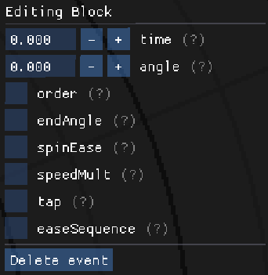

|              |                                                                          |
|--------------|--------------------------------------------------------------------------|
| time         | On which beat will the item hit Cranky.                                  |
| angle        | On which rotation angle should the item start.                           |
| order        | In what order should this item be drawn (lower has higher priority)      |
| endAngle     | The rotation angle the item should end on.                               |
| spinEase     | The ease this item uses while changing rotation (Note: currently broken) |
| speedMult    | Multiplies the current scrollSpeed by this number only for this item.    |
| tap          | Adds a tap note to this item. (Not applicable to Mines)                  |
| color0       | Which color is responsible for coloring the note filling?                |
| color1       | Which color is responsible for coloring the note outline?                |
| easeSequence | Ease sequences explained later in the guide!                             |

### Bounces

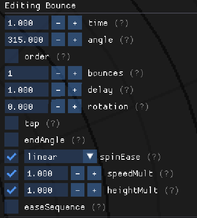

|              |                                                                       |
|--------------|-----------------------------------------------------------------------|
| time         | On which beat will the item hit Cranky.                               |
| angle        | On which rotation angle should the item start.                        |
| order        | In what order should this item be drawn (lower has higher priority)   |
| bounces      | How many times the note will bounce                                   |
| delay        | Time between the bounces                                              |
| rotation     | Rotation that will happen between each bounce                         |
| tap          | Adds a tap note to this item.                                         |
| endAngle     | The rotation angle the item should end on.                            |
| spinEase     | The ease this item uses while changing rotation                       |
| speedMult    | Multiplies the current scrollSpeed by this number only for this item. |
| heightMult   | Multiplies the bounce height by this number only for this item.       |
| easeSequence | Ease sequences explained later in the guide!                          |

### Holds and Mine Holds

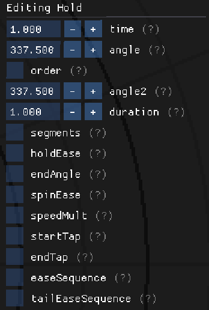

|                    |                                                                                            |
|--------------------|--------------------------------------------------------------------------------------------|
| time               | On which beat will the hold hit Cranky.                                                    |
| angle              | On which rotation angle the hold starts.                                                   |
| order              | In what order should this hold be drawn (lower has higher priority)                        |
| angle2             | On which rotation angle the hold ends.                                                     |
| duration           | How many beats the hold lasts.                                                             |
| segments           | How many straight lines the hold has.                                                      |
| holdEase           | What ease the hold should use when going from angle to angle2.                             |
| endAngle           | The rotation angle the first hold beat ends up at.                                         |
| spinEase           | The ease this hold uses while changing rotation (Note: currently broken)                   |
| speedMult          | Multiplies the current scrollSpeed by this number only for this item.                      |
| startTap           | Adds a tap note to the beginning of the hold. (Not applicable to Mine Holds)               |
| endTap             | Adds a tap note to the end of the hold. (Not applicable to Mine Holds)                     |
| easeSequence       | Apply ease sequence to the head of the hold (Ease sequences explained below)               |
| taileaseSequence   | Apply ease sequence to the tail of the hold (Ease sequences explained below)               |
| Minehold exclusive |                                                                                            |
| tickRate           | If the minehold has been hit, how frequently should it check for hits? (Measured in beats) |

### Extra Taps

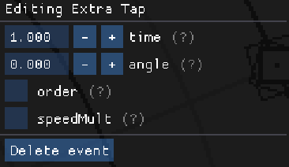

|              |                                                                            |
|--------------|----------------------------------------------------------------------------|
| time         | On which beat will the extra tap align with Cranky.                        |
| angle        | Used for organization                                                      |
| order        | In what order should the extra tap be drawn (lower has higher priority)    |
| speedMult    | Multiplies the current scrollSpeed by this number only for this extra tap. |
| color1       | Which color channel is responsible for the color of the tap?               |
| easeSequence | Ease sequences explained later in the guide!                               |

---

## VFX section

### Ease

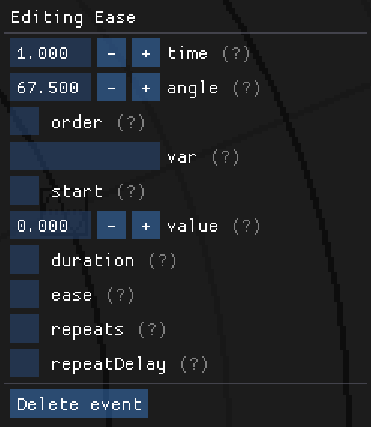

time

On which beat will this event be executed.

angle

Used for organization

order

In what order should this event be executed (lower has higher priority)

var

Variable to ease (All variable names are listed on page 10)

start

Should this variable start at a value before easing?

value

The value this variable should ease to.

duration

How many beats the ease should last.

ease

Which ease function should be used while easing the variable.

repeats

Should this ease event repeat?

repeatDelay

How many beats should be in-between repetitions.

(If this is off, it instead uses the duration as a delay.)

Besides all the variables in the Easables section of this guide, you may also access individual properties of decoration and 3d decoration events by inputting vfx.deco.&lt;id&gt;.&lt;variable&gt; and  vfx.deco3d.&lt;id&gt;.&lt;variable&gt;.

### Ease Sequence

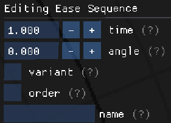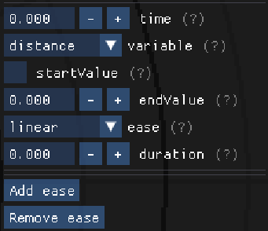

|      |                                            |
|------|--------------------------------------------|
| name | Name that will represent the ease sequence |

Description:

Ease sequences allow you to use a series of eases in order to change the distance and angle of upcoming notes at will.

- Changing the distance variable will dynamically change how far away the note is from cranky. The distance is measured in beats, meaning that at time = -1 the note is 1 distance away. Time equals 0 when the note hits the paddle.

{/*THE END*/}

- Changing the angle variable, will dynamically change the angle the note is coming from, relative to its original position. Meaning if you want to move a note clockwise you would use positive values, and using negative values will move it counter-clockwise

Example:

|                                     |                                             |
|-------------------------------------|---------------------------------------------|
| These mines in the level DAMOCLISM: | Are done using the following ease sequence: |
|             |                      |

### Decoration

### 

order

Sets order of priority for the deco event itself. 

Helpful for events running on the same beat that alter different properties &amp; easings for the same deco.

id

Allows you to assign and call specific IDs associated with a deco, making it easier to modify specific deco events without re-adding input for the “sprite” property.

parentid

Unique id of the parent deco (If the Id does not exist, the decoration will not have a parent) (can also parent to cranky by putting ‘@player’ in the field) 

Setting a parent makes the decorations coordinate system be based around the parent, meaning that position (0,0) for said event is now the position of its parent. And moving the parent will also move the “child”.

rotationinfluence

How much the parent’s rotation influences the child deco

orbit

Only rotates the position of the deco, not the angle (applies to parented decos only)

sprite

Controls the image/animations the deco has (via filename entry) (will be the bubbletabby cat by default, if the field is left blank)

x/y

X &amp; Y positions. Relative to the screen, 0 is left/top and increasing values move further right/down.

r

Angle of rotation

sx/sy

Scaling along the X &amp; Y planes

ox/oy

Offsets the “center point” that position, rotation, scale, and skew are based off of. Is located at the top-left pixel by default

kx/ky

Skews the image on the x or y axis.

mirror

Mirrors the decoration based on the horizontal or vertical axis

exclusiveMirror

If left unchecked, will display both the original and mirrored copy of the decoration when mirror is enabled

drawLayer

Assigns decos to render on the foreground (fg,) background (bg,) or top (ontop) layer. (The top layer is unaffected by VFX that apply to fg/bg layers. )

drawOrder

Further sorts decos within the same layer.

recolor

Displays the deco as a single solid color

outline

Toggles whether the “Outline” VFX event applies to this decoration.

hide

Toggles whether the deco is hidden or not.

tiling

Enables the ability to tile the decoration and consists of uvx/uvy and uvdx/uvdy.

Changing vx/vy changes the position of the tiled decoration statically.

Changing dx/dy makes the decoration move constantly. (Best when using values 0-1)

For example you could mimic the effect of dx/dy by easing the value of vx/vy

alphadither

Enables alpha dithering, meaning the decoration becomes transparent when dithered

ditherpercent

How dithered the decoration is. 1 being not at all and 0 being totally dithered

effectCanvas

Is explained in detail, in a section above

duration

Not applicable for deco creation events.  Sets the duration it takes for a deco to undergo the given transformation from its initial state.

ease

Not applicable for deco creation events.  Sets the easing a deco’s transformation uses.

### Hall Of Mirrors


|        |                                                |
|--------|------------------------------------------------|
| enable | Should Hall Of Mirrors be enabled or disabled? |

Hall of Mirrors is an effect that draws the canvas every frame without clearing it. This event synergizes well with Noise to create a sort of “trail” effect behind objects.

|                          |                                              |
|--------------------------|----------------------------------------------|
|  |                       |
| HoM enabled              | HoM enabled with Noise enabled at 0.5 chance |

---

### Noise


chance

Chance per pixel to be completely transparent

(0 disables Noise, 1 will always place a clear pixel)

color

Which color channel should the noise shader use?

timeStep

What is the time step factor for the noise? (How long between each update)

pixelate

What is the pixelation factor for the noise? (Bigger number, bigger pixels)

The Noise event covers the background with the color chosen. Chance dictates how likely it is,  for every pixel on the canvas, that a clear pixel is placed instead. Works very well with Hall Of Mirrors. When used with Hall Of Mirrors, a higher value means more “smearing”.

|                                                                           |                         |                          |
|---------------------------------------------------------------------------|-------------------------|--------------------------|
|                                                    |  |  |
| Noise with 0.25 chance                                                    | Noise with 0.5 chance   | Noise with 0.75 chance   |
| Using channel 0 as the background color and channel 1 as the Noise color. |                         |                          |

### Set Color


color

Color index to change

R,G,B,

The color value to change the index to

(Click the box beside the RGB values to open a color picker and hex value acceptor)

Enable red channel

Will this channel be affected when changing colors?

Enable green channel

Enable blue channel

duration

How long (in beats) will it take to change to this color?

ease

Which ease function should be used while changing colors?

### Set joystick Color


“Joystick color” refers to the light that exists on ps4 and ps5 style controllers.

color

What color channel will the light be tied to? (if you don’t set this the light is considered “off”)

startFlash

The value of the flash color, and the current color channel are “added”* together to display the final color.

How much the flash color affects the final result is determined by the start/end-Flash values. (They range from 0-1, meaning, at 0: it doesn’t contribute at all, at 0.5: it's an event mix between the flash color and the current color channel and at 1: the flash is solely responsible for the end color.)

If you wish to ease the flash value around, changing the start and end values separately will change the color and strength the flash will have at the start and end of the easing. (otherwise you may only set the “end” values)

endFlash

startColor

endColor

\*It’s a linear interpolation between the two colors

You may use the “Additional playtest info” to view the output color.

Whatever color the “Output” text has, will be what shows on the controller.

Below is the playtest info from the level “Destroy Destroy”


### 

### Edit Player


|                |                                                                                   |
|----------------|-----------------------------------------------------------------------------------|
| spriteName     | Which facial expression should cranky have?                                       |
| useFaceStencil | Crop the face sprite to the players body? (example in the next page)              |
| shader         | What shader to use to affect the player?                                          |
| canvas         | Which canvas should cranky be drawn on? (explained further in the canvas section) |
| layer          | Which layer should cranky be drawn on?                                            |

Using this event changes cranky’s facial expression. Depending on what you input into the “spriteName“ field cranky’s face will be locked into the expression you specify. There are 15 expressions available in game by default:

|                          |                          |                          |                          |                          |
|--------------------------|--------------------------|--------------------------|--------------------------|--------------------------|
| none                     | idle                     | miss                     | angry                    | :3                       |
|  |  |  |   |   |
| happy                    | &gt;&lt;                 | closed                   | halfclosed               | xx                       |
|  |  |  |  |  |

|                          |                         |                         |                          |                          |
|--------------------------|-------------------------|-------------------------|--------------------------|--------------------------|
| sad                      | unimpressed             | dots                    | wink                     | spiral                   |
|  |  |  |  |  |

Leaving the field blank in a Force Player Sprite event will reset cranky’s expression back to the default state, which means cranky will be able to react accordingly to changes in combo.

It is also possible to create your own custom expressions by entering the image’s file name into the “spriteName” field ( don’t forget to include the file extension i.e. “.png” inside the field! ). The recommended file size is 40x40 pixels, as that is the size the game uses for the above expressions.

An example of the faceStencil is the “antique” skin, that has the following as its face sprite, but has the stencil setting enabled.


### AFT


|          |                                                                                     |
|----------|-------------------------------------------------------------------------------------|
| id       | What is the ID tied to the AFT? Accessible in a deco by prefixing ‘@aft’ to the id. |
| duration | What is the duration of the capture? Use 0 for a single frame.                      |

The AFT (standing for Actor Frame Texture) is an object that captures everything happening on screen currently, and saves it as a decoration.

To use the captured frame or sequence of frames you need to place down a decoration event and insert ‘@aft’ + the AFT’s id into the “sprite” field.

For an AFT that looks like this:

You’d input the following into

a decoration event:


Putting the decoration containing the AFT on the ‘ontop’ layer will

cause it to not be captured.

### Stamp


|                      |                                                                                                                                                                                                                                                                                                            |
|----------------------|------------------------------------------------------------------------------------------------------------------------------------------------------------------------------------------------------------------------------------------------------------------------------------------------------------|
| stampName            | What is the name tied to the stamp?                                                                                                                                                                                                                                                                        |
| sprite               | Image used for the stamp, only to be set when a stamp is initialized.                                                                                                                                                                                                                                      |
| canvasID             | What is the id of the canvas the stamp will be on? Accessible in a deco by prefixing ‘@stamp’ to the id.                                                                                                                                                                                                   |
| Positional arguments | All the position arguments determine where and how the stamp will be placed on the specified canvas.                                                                                                                                                                                                       |
| clear                | Clears the canvas of all stamps placed                                                                                                                                                                                                                                                                     |
| randomise            | Randomises the sprite from a given spritesheet within the Min-Max limits. (example: if your given sprite is part of a spritesheet i.e. you’ve inputted “spritesheet#0” each time the level is played, a random sprite will be picked from said spritesheet using an index within the range you provided. ) |

The stamp tool allows you to place a piece of decoration on a secondary canvas, which can then be accessed and manipulated inside a decoration event. This canvas is fully transparent.

i.e. if you give your canvas the ID testcanvas1, the sprite field inside your decoration should be @stamptestcanvas1

For an example of this event in action, check out the level UNDO UNDO, all the small decorations placed on screen are made using this event instead of all being contained inside individual decoration events.

### New canvas / Edit canvas

“Show advanced events” setting required for this event


|            |                                                           |
|------------|-----------------------------------------------------------|
| id         | What is the name tied to the canvas?                      |
| width      | What is the width (in pixels) of the canvas?              |
| height     | What is the height (in pixels) of the canvas?             |
| clearColor | Which color channel to clear with? (-1 being transparent) |
| doClear    | Clears the canvas.                                        |

Essentially, the canvas is a transparent surface upon which other objects, such as notes, decorations, the player (through an edit player event), 3D camera feed, text decorations and others can be drawn.  
After something is drawn on a canvas it will now be drawn onto the canvas instead of where it was drawn before. The canvas can then be accessed inside of a decoration event by adding @canvas  followed by the id you’ve set inside of the sprite field. (i.e. if your id is set to “canvas1” inside the sprite field you’d put @canvascanvas1)

The fact that notes or the player are now inside a decoration event, means they’re now susceptible to manipulation, such as being moved, scaled or have shaders applied.

Important: Canvases are sensitive to the draw layer! Meaning, when using a decoration to draw the canvas on screen only objects that are on a lower layer will be drawn and any object that is on an equal or higher layer will be skipped over. (i.e. if you’ve set the player to be drawn on layer 10, and the decoration containing the canvas is set to “bg” the player will not be rendered\*)

\*note: bg is layer -999, fg is layer 999 and zero is well… 0

You can also use the boolean vfx.notesDefaultOnPlayerCanvas . It is by default set to true, and it means notes are automatically set to be on the same canvas as cranky (if cranky has been put inside of a canvas in the first place).

### Deco shader / Shader Uniform

“Show advanced events” setting required for these events

Deco Shader

name

What name will be tied to the shader?

source

file: a glsl file inside your level folder. strings: glsl code directly inside beatblock

It is recommended to always use a file.

file

What is the name of the file? (i.e. “shaderFIle.glsl”)

Shader Uniform

shader

What is the name of the shader? (what was inputted in the “name” field)

var

What is the name of the uniform that will be eased? (defined in your shader)

For a detailed explanation of how shaders work check out [this](https://www.google.com/url?q=https%3A%2F%2Fdocs.google.com%2Fdocument%2Fd%2F1UvGHnSv9XMHRBJl2RU3YOC93ODGR-rpGCHakY9fBVj4%2Fedit%3Fusp%3Dsharing&sa=D&source=editors&ust=1795465856868714&usg=AOvVaw2OQ4i5gw23ljuSt2oQX9ZP) community written guide.

### Text Decorations


|                  |                                                                             |
|------------------|-----------------------------------------------------------------------------|
| text             | What text will be displayed?                                                |
| font             | Which font will be used to display the text? (more about fonts below)       |
| colour           | Which color channel will the text be tied to?                               |
| wrapLen          | At what width (in pixels) will the text wrap? (leave at -1 for no wrapping) |
| extraCharSpacing | How many pixels are between each individual character?                      |
| justification    | How will the text be centered?                                              |
| outline          | Will the text be outlined?                                                  |
| specialoutline   | Adds an additional pixel of black around the text.                          |
| kyFake           | Moves characters this many pixels down compared to the last character.      |

#### Available Fonts

What will be entered into the “font” field

What it looks like in game

digitalDisco


main


jfdot


jfdot2


terminal


ancient


terminalTall


terminalTallFixedWidth


terabyte


small


blowafuse

Font name: Tabloid Scuzzball


rsUI


aucontraire

(note: very large)

Font name: ministry of moron


calmcontraire

Font name: Four Mad Dogs


censorblock

Note: supports only the character “X”, falls back to terminal for everything else


Text event has the following:  The quick XXXX fox XXXXX over the XXXX dog.

acgradient

(note: also very large

\-

This font has black pixels in it by default, make sure to set its color to be something other than black)

/

acgradientoutlines

(makes the font no longer contain black pixels inside the letters, meaning the inside of the letters is now transparent)


undocrash

(note: very small)


blocks

/

blocksoutlines

(makes the inside of the blocks transparent leaving only the outlines)


The text event has the following string: nhibsmMgtB

Everything outside those specific characters will not render.

warez


notosans

(note: quite large)


fatale

(note: quite large)

/

fatalesolid

/

fataleoutline


leipziger


\*Screenshot credits to @not\_unity

#### Advance text Decoration

To use this event, you must separate the syllables in the text field using “|”

Example:

|                                    |                                                                    |
|------------------------------------|--------------------------------------------------------------------|
| By formatting your text like this: | And using Advance Text Decoration events, can get you this result: |
|             |                                            |

#### Available text triggers (RTF tags)

You would insert these into the “text” field of the event, before whatever you’ve typed. Replace whatever is on the right side of the equals with a number (i.e. you would input \[shake=1] shake  into the text field for the first example)

These can also be used in fields such as the title,description or charter field of your chart. There are some restrictions however:

The fonts aucontraire , acgradient , ancient , blowafuse and the tags \[offset] , \[scale] , \[scalex] , \[scaley] , \[input] are not able to be used inside your titles.

A full list of available tags is available below:

Tag name and description

In game appearance

\[shake=strength]

Causes individual letters to randomly displace by up to (strength) px / frame


\[shakeslow=strength]

Causes individual letters to randomly displace by up to (strength) px, changes at a rate dictated by slowtextchangerate


\[rotate=strength]

Causes individual letters to rotate, with a circle of (strength)px radius


\[scale=size]

Scales individual characters in a string to (size)x size - use with \[extraCharSpacing] for best results


\[\_\_\_X=strength] / \[\_\_\_Y=strength]

Add X or Y next to any of the tags listed directly above to affect only individual axes (eg. \[shakeY=strength])


\[offset=x,y]

Offsets the rendered characters by  (x, y) pixels


\[chrRotate=deg] / \[charRotate=deg] / \[chrRotation=deg] / \[charRotation=deg]

Rotates the rendered characters by (deg) degrees, individually


\[chrRotateMult=amt]

Multiplies the rotation point of characters

 

use 0 for top-left and 2 for bottom-right

\[chrRotateMultX] &amp; \[chrRotateMultY] work as you’d expect

Changing chrRotate with chrRotateMult = 0


Changing chrRotate with chrRotateMult = 1


\*how to slowly change the rotation amount or do similar effects is explained further in the variables section

\[rotateShake=deg] / \[shakeRotate=deg]

Causes characters to randomly rotate up to (deg) degrees away from their usual render position


\[rotateShakeSlow=deg] / \[shakeRotateSlow=deg]

Does the same as \[shakeRotate], but doesn't update every frame


\[font=fontname]

Sets current font mid-line


\[glitch=chance]

(chance)% to replace any non-space, non-barline character with a random character

Can use \[glitchChance=percent], to make censor only have a percent change to apply each frame


\[glitchSlow=chance]

Does the same as \[glitch], but doesn't update every frame

Similarly has: \[glitchChanceSlow=percent]


\[censor=chance]

(chance)% to replace any non-space, non-barline character with a space

Can use \[censorChange=percent], to make censor only have a percent change to apply each frame


\[censorSlow=chance]

Does the same as \[censor], but doesn't update every frame

Similarly has: \[censorChangeSlow=percent]


\[glitchTextChangeRate=rate]

Makes  \[glitchSlow] and \[censorSlow] get applied every rate/60 seconds

\[input=inputname,yOffset]

Draws an icon for the input (inputname) at the current position

Press \[input=back] to return to menu


\[xduplicate=distance]

Duplicates the text the inputted amount of pixels to the right


\[dropshadow=px,col] / \[dropshadow=x,y,col]

Duplicates the text the inputted amount down and to the right.


\[color=id] or \[colour = id]

Sets the colour of the text to channel (id)


\[charspacing=px] or \[charspace=px] or \[width=px]

Adds (px) extra pixels between each character - can be negative


\[reset]

Resets the state of all set RTF triggers.

\[var=variable]

tag is replaced with the contents of a certain variable, full list of variables is as follows:

(i.e. you would write \[var=combo] to display the current combo)

bpm

The current bpm of the song - affected by ratemod

difficulty

The difficulty of the song

combo

The current player combo

misses

The current player miss count

barelies

The current player barely count

perfects

The current player perfect count

accuracy

The current player accuracy

songname / title

The title of the song

beat

The current beat of the song

time

The current realtime second of the song - unaffected by ratemod

formattedtime

The same as above, formatted into HH:MM:SS.ms

vfx\_(anything)

The value of any variable starting with vfx. In the easables section (e.g. vfx.noteXScale can be obtained with vfx\_notexscale)

vfxnum# does the same, but cuts of the decimals of the result and makes it at minimum # characters long. (only to be used with numbers)

i.e. if vars0 has a value of 12.133, vfxnum3\_vars0 will make it display 012 ,removing the decimals and making it 3 characters long

vfxnum#\_(anything)

vfx\_vars(number 0 to 100)

The easables vfx.vars0 to vfx.vars100 are empty variables available for you to change in an ease event.

You may then use these inside all the aforementioned text tags as values, which was how the chrRotateMult example from earlier functioned. So as an example you can do the following: \[chrRotate=\[var=vfx\_vars0]] your text here

And then put vfx.vars0 into an ease event to make your characters slowly spin

Nested tags like these only function when accessing variables with \[var=variable]

#### Load Custom Font

Allows the importing of other fonts for use in the Text Decoration Event

fontpath

The name of the font file (i.e. CoolFont.ttf)

characterMap

Which character map to use for pixel fonts (meaning it’s only relevant for .png font files).

'regular' loads characters 32\~126 (space through \~)

 'full' loads characters 32\~255 and Ω (space through ÿ, except character 127, with Ω on the end)

'custom' gives you a new customMap textbox that lets you define what characters you're loading on your own

ttfFontSize

Size to render truetype fonts at. (Ignored if using a pixel font)

pixelCharSpacing

Pixels between individual characters (Ignored if using a truetype font)

fallbackFont

What font should be used if this font is missing characters? (this font has to be the same type (ttf, png) as the fallback)

If you're using internal fonts as a fallback, main/digitalDisco/jfdot/jfdot2 are TTF, the rest are Pixel

Example: If your font file is called “CoolFont.ttf” into the “font” field of the Text Decoration event you’d insert “CoolFont”

.ttf/.fnt files are fairly drag and drop, .png font files have to be made to follow the[](https://www.google.com/url?q=https%3A%2F%2Flove2d.org%2Fwiki%2FTutorial%3AFonts_and_Text&sa=D&source=editors&ust=1795465856901890&usg=AOvVaw1hoW04qQEACjko9FrV5mqC)[love2d internal format](https://www.google.com/url?q=https%3A%2F%2Flove2d.org%2Fwiki%2FTutorial%3AFonts_and_Text&sa=D&source=editors&ust=1795465856901990&usg=AOvVaw243bCBm2g0RzwxjxrLyB3v) to work properly

---

## Gameplay section

### Edit Paddle


|          |                                                                                                                                                                                                  |
|----------|--------------------------------------------------------------------------------------------------------------------------------------------------------------------------------------------------|
| enabled  | Whether the selected paddle should be enabled or disabled. (The first checkbox puts the setting into use, and the second one determines whether the selected paddle will be enabled or disabled) |
| paddle   | The index of the paddle that will be edited (1 being the paddle that already exists) (inputting 0 will select all paddles)                                                                       |
| newWidth | What will the new width of the selected paddle be?                                                                                                                                               |
| newAngle | What will the new angle of the selected paddle be?                                                                                                                                               |
| duration | How long (in beats) will it take to change this paddle (doesn’t work with enabling)                                                                                                              |
| ease     | Which ease function should be used while changing the paddle (doesn’t work with enabling)                                                                                                        |

Example usage:

 In order to give cranky an additional paddle, you would have to select a paddle index other than 1 (i.e. 2), use both “enabled“ checkboxes (the first putting the setting in use, and the second making your new paddle exist) and lastly you need to give the paddle an angle other than 0, so that it doesn't overlap with your existing paddle.

### Set Bounce Height


|        |                                                      |
|--------|------------------------------------------------------|
| Delay  | Bounces with this delay will be affected             |
| Height | How high should the note bounce? (measured in beats) |

This event mass changes the bounce height for all bounce notes of a given delay.  
For example if you change the height in a field with delay 2, from that point onward, every bounce placed in your level that has a delay of 2 will now bounce as high as you have just specified.

If you set a heightMult inside the bounce note itself, this will override whatever height was inputted in the set bounce height event. 

---

## Editor section

### Bookmark / Comment


These events are grouped together because both of them are  only visible inside the editor and don’t have any effects on the actual level.

Bookmarks are particularly useful for marking out sections in your levels. Using them will split up the timeline that shows up when holding down the “Alt” key, allowing for faster navigation around the editor:


Also, using Alt+Right/Left arrow will make you jump to the next section immediately.

Comments can be used if you want to leave notes for anyone that might check out your level in the editor (or just for leaving notes for yourself!)

---

### Tags / Run tag


|             |                                                                                                         |
|-------------|---------------------------------------------------------------------------------------------------------|
| tag         | What is the name of the tag’s file? (without the .json extension)                                       |
| angleOffset | Offset new events by this event’s angle? (currently doesn’t function for angle2 on holds and mineholds) |

Description:

Tags are essentially a folder containing a series of events (stored in text format, instead of being shown in the editor), used to prevent crowding in the editor or to more easily place a series of events repeatedly.

|                                                                                                                          |
|--------------------------------------------------------------------------------------------------------------------------|
| To create a tag, use Shift+click (or Alt+Drag click)to select the events you want to tag, and then click “Change to tag” |
|                                                                                                   |

|                                                                                                                                 |
|---------------------------------------------------------------------------------------------------------------------------------|
| And then enter your desired name and click on “Make tag” (this is what you’ll insert into the “tag” field of the Run tag event) |
|                                                                                                         |

A new “tags” folder has now been created inside the folder where your chart is located, containing the newly created tag. You can edit this file however you like, as long as you follow JSON formatting (an online json formatter, or a code editor can be used to make editing much easier).

The “time” field for all the events  is based around where the “Run tag” event will be placed inside your level. So, the events at 0 are where the “Run tag” event is located exactly, and any higher value counts the amount of beats after the initial event. Negative values do work.


